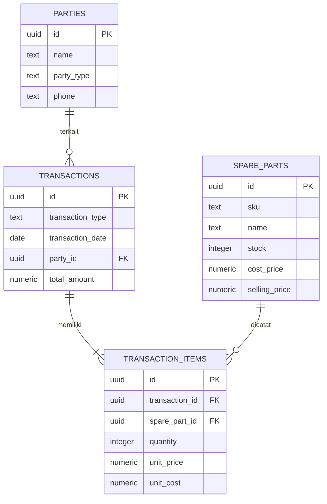

# RodaKas — Sistem Akuntansi Sparepart Motor

Aplikasi sederhana untuk mencatat persediaan, pembelian, penjualan, dan estimasi laba kotor. ERD terdiri dari empat entitas: `parties`, `spare_parts`, `transactions`, dan `transaction_items`.



## Menjalankan aplikasi

1. Buat project Supabase, lalu jalankan seluruh isi [`backend/schema.sql`](backend/schema.sql) melalui SQL Editor Supabase.
2. Atur variabel lingkungan `SUPABASE_URL` dan `SUPABASE_SERVICE_ROLE_KEY` pada terminal. Gunakan **service role key hanya di backend**; jangan masukkan key ini ke frontend atau unggah ke repositori.
3. Pastikan Node.js 18 atau lebih baru tersedia, lalu jalankan `node backend/app.js` dari folder proyek.
4. Buka `http://localhost:3000`.

Contoh pengaturan variabel di PowerShell:

```powershell
$env:SUPABASE_URL = "https://project-ref.supabase.co"
$env:SUPABASE_SERVICE_ROLE_KEY = "service-role-key"
node backend/app.js
```

Pembelian menambah stok dan memperbarui harga pokok rata-rata tertimbang. Penjualan memeriksa stok, menguranginya, serta menyimpan harga pokok saat transaksi untuk perhitungan estimasi laba kotor. Tambahkan pemasok dan sparepart, lalu catat pembelian sebelum mencatat penjualan. Setiap transaksi dapat berisi lebih dari satu barang.

Menu **Laporan** menyediakan ringkasan penjualan, pembelian, dan estimasi laba kotor berdasarkan rentang tanggal, serta ekspor rincian transaksi ke CSV.

Sparepart dan kontak dapat diedit atau dihapus dari tabel masing-masing. Penghapusan ditolak bila data sudah digunakan dalam transaksi, agar riwayat akuntansi tetap utuh.

Transaksi juga dapat diedit atau dihapus dari tabel riwayat. Perubahan transaksi menghitung ulang stok dan harga pokok secara atomik; bila penyesuaian akan membuat stok tidak mencukupi pada transaksi berikutnya, perubahan dibatalkan. Sebelum memperbarui aplikasi yang sudah berisi data, buat backup Supabase, hentikan server, kemudian jalankan seluruh file [`backend/schema.sql`](backend/schema.sql) di SQL Editor Supabase untuk memasang kolom dan fungsi migrasi terbaru. Jika migrasi melaporkan saldo awal tidak konsisten, hentikan proses dan periksa stok serta riwayat transaksi; jangan hapus data untuk mengatasi error.

Tidak memerlukan `package.json` atau file `env.example`; server menggunakan modul bawaan Node.js dan API Supabase melalui REST.
